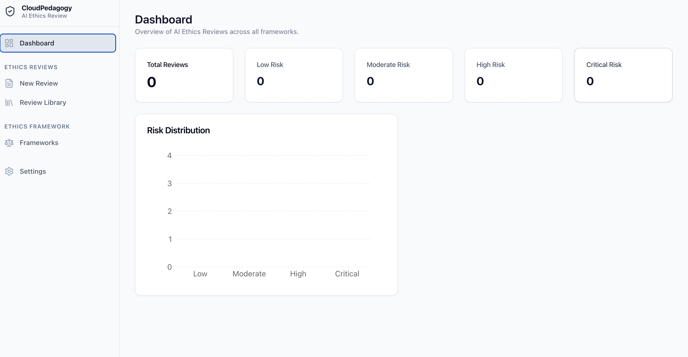
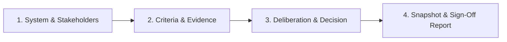

# CloudPedagogy AI Ethics Review

Local-first governance tool for structured ethical review of AI-supported systems, educational workflows, and algorithmic outputs using configurable frameworks, transparent scoring, evidence capture, human deliberation, and governance-ready reporting.

🌐 **Live Hosted Version:**  
http://cloudpedagogy-ai-ethics-review.s3-website.eu-west-2.amazonaws.com/#/frameworks

🖼️ **Screenshot:**  


---

## Overview

The **CloudPedagogy AI Ethics Review** tool is a specialized, local-first web application designed to bridge the gap between AI technical capability and ethical accountability. It allows administrators, researchers, educators, and governance teams to systematically evaluate the ethical dimensions of AI-supported tools and workflows. 

By combining customizable frameworks, transparent decision-support calculation, non-compensatory red-flag rules, structured stakeholder impact analysis, and qualitative reviewer deliberation, organizations transform subjective ethical principles into structured, auditable governance artifacts.

---

## Key Features

* **Assessment-Time Framework Snapshots (Highest Integrity)**: Completed reviews capture an immutable, deep-copied snapshot of the active framework definition (criteria, scoring scales, weights, thresholds, rules, safeguards). Subsequent edits or deletions of custom frameworks will never distort historical evaluations.
* **Human-in-the-Loop Deliberation**: The calculation engine serves as decision support, not autonomous evaluation. Lead reviewers record their own concluded risk tier, provide reasoned conclusions, and supply mandatory deviation justifications if overriding algorithmic advisory baselines.
* **Stakeholder Impact Analysis**: Dedicated analysis mapping affected stakeholder cohorts, protected interests, anticipated benefits, and specific risks or concerns.
* **Evidence & Uncertainty Register**: Evidence items linked to evaluations with explicit verification statuses (`Verified`, `Partially Verified`, `Unverified Claim`) and qualitative uncertainty disclosures.
* **Comprehensive Framework Builder**: Full management of general metadata, criteria with inline editing and rule-dependency protection, continuous threshold boundaries with configuration validation, non-compensatory red-flag rules, and actionable safeguards.
* **Review Lifecycle Management**: Save in-progress drafts, resume drafting anytime, and create explicit reassessment revisions with historical traceability (`isRevisionOf`).
* **Resilient Historical Reports**: Reviews render completely even if original frameworks are edited or deleted, with automatic snapshot fallback and print-optimized PDF sign-off blocks.
* **Local-First & Offline Privacy**: All assessment records and framework rubrics stay inside browser storage (`ethics-review-storage`). Zero external network calls, zero telemetry, full offline capability.
* **Accessible & Responsive**: WCAG 2.1 AA compliant semantic landmarks, keyboard-accessible tabs, visible focus rings, and mobile-friendly responsive sliding drawer navigation.
* **Production Hardened**: Lazy-loaded routes with Vite code-splitting and an automated test suite of 47 tests across calculation, deliberation, schema validation, and snapshot integrity.

---

## Ethical Review Workflow



1. **System & Stakeholder Context**: Define system identity, deployment context, operational purpose, and map impacts across student, faculty, or public cohorts.
2. **Criteria Scoring & Evidence**: Score criteria against calibrated rubrics, log qualitative justifications, and record supporting evidence items with verification levels.
3. **Deliberation & Decision**: Review decision-support scoring and triggered red flags, record human rationale, reconcile discrepancies, and assign operational safeguards.
4. **Snapshot & Final Report**: Finalizing an assessment locks an assessment snapshot for audit reproducibility and produces an exportable/printable sign-off report.

---

## Scoring & Assessment Architecture

The pure assessment engine ([`src/utils/assessmentEngine.ts`](src/utils/assessmentEngine.ts)) computes a weighted percentage using continuous boundary conventions:

$$\text{Criterion Score Contribution} = \text{Score} \times \text{Weight}$$
$$\text{Total Score} = \sum (\text{Score}_i \times \text{Weight}_i)$$
$$\text{Maximum Possible Score} = \sum (\text{Max Score}_i \times \text{Weight}_i)$$
$$\text{Percentage Score} = \frac{\text{Total Score}}{\text{Max Possible Score}} \times 100$$

* **Threshold Mapping**: Percentages are evaluated against configured thresholds using continuous interval boundaries ($[0, 25.5)$, $[25.5, 50.5)$, $[50.5, 75.5)$, $[75.5, 100]$).
* **Non-Compensatory Red Flags**: Conditional rules elevate recommendations (e.g. to *Critical Risk*) regardless of high overall numeric totals if an unacceptable risk threshold or condition is met.
* **Human Primacy**: Advisory outcomes inform but do not bind the human reviewer's final determination.

---

## Repository Structure

```
├── .github/
│   └── workflows/
│       └── ci.yml              # GitHub Actions CI matrix (Node 18.x, 20.x)
├── assets/                     # Graphics assets (e.g. screenshot.png)
├── public/                     # Static public assets (favicon.svg)
├── src/
│   ├── components/             # Reusable UI & domain components
│   │   ├── framework/          # Framework builder tabs (General, Criteria, Thresholds, Rules, Safeguards)
│   │   ├── layout/             # Responsive AppLayout and mobile Sidebar
│   │   └── ui/                 # Core accessible UI components (Button, Card)
│   ├── models/                 # Core TypeScript definitions (types.ts)
│   ├── pages/                  # Lazy-loaded route views
│   │   ├── Dashboard.tsx       # System-wide metrics & risk distributions
│   │   ├── FrameworkBuilder.tsx# Framework rubric and rule editor
│   │   ├── Frameworks.tsx      # Framework template management
│   │   ├── NewReview.tsx       # 3-step structured review wizard
│   │   ├── ReviewReport.tsx    # Comprehensive review report & print layout
│   │   ├── Reviews.tsx         # Review library with filtering & revisions
│   │   └── Settings.tsx        # JSON backup import/export & storage management
│   ├── store/                  # Zustand state management
│   │   ├── defaultData.ts      # Standard starter frameworks & sample reviews
│   │   ├── useStore.ts         # Reactive store with safe localStorage adapter
│   │   └── __tests__/          # Store persistence unit tests
│   ├── utils/                  # Pure domain engines & validators
│   │   ├── assessmentEngine.ts # Pure calculation, thresholds, & rule evaluator
│   │   ├── validation.ts       # Strict JSON import payload validation
│   │   └── __tests__/          # Automated Vitest test suites
│   │       ├── assessmentEngine.test.ts
│   │       ├── batch2Deliberation.test.ts
│   │       ├── batch3Hardening.test.ts
│   │       └── validation.test.ts
│   ├── App.tsx                 # Route code-splitting with Suspense
│   ├── index.css               # Tailwind CSS directives
│   └── main.tsx                # React DOM entry point
├── index.html                  # HTML shell
├── package.json                # Project dependencies & test scripts
├── tailwind.config.js          # Tailwind design tokens
├── tsconfig.json               # TypeScript configuration
└── vite.config.ts              # Vite configuration with Vitest integration
```

---

## Verification & Testing

The repository includes a comprehensive Vitest automated test suite covering assessment scoring, red-flag triggers, boundary midpoints, deliberation overrides, import validation, and snapshot immutability:

```bash
# Run full automated test suite
npm test

# Run ESLint validation
npm run lint

# Build production bundle (with route code-splitting)
npm run build
```

---

## Local Development

Ensure [Node.js](https://nodejs.org/) (version 18+ or 20+) and npm are installed.

```bash
# Clone the repository
git clone https://github.com/cloudpedagogy/cloudpedagogy-ai-ethics-review.git
cd cloudpedagogy-ai-ethics-review

# Install dependencies
npm install

# Start development server
npm run dev
```

Navigate to `http://localhost:5173/` in your browser.

---

## Governance & Regulatory Notice

**Notice & Limitations:** This application produces internal, structured ethical review and decision-support artifacts. It documents qualitative human deliberations, stakeholder considerations, and prescribed safeguards. This evaluation does not constitute statutory compliance certification, GDPR/FERPA clearance, or formal third-party algorithmic assurance.

---

## License

Licensed under the [MIT License](LICENSE).
